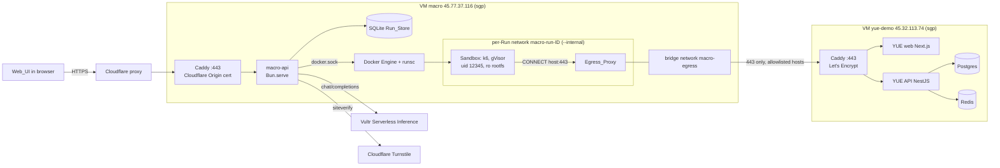
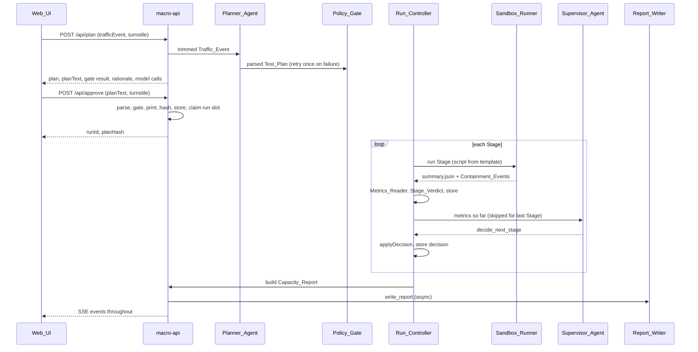
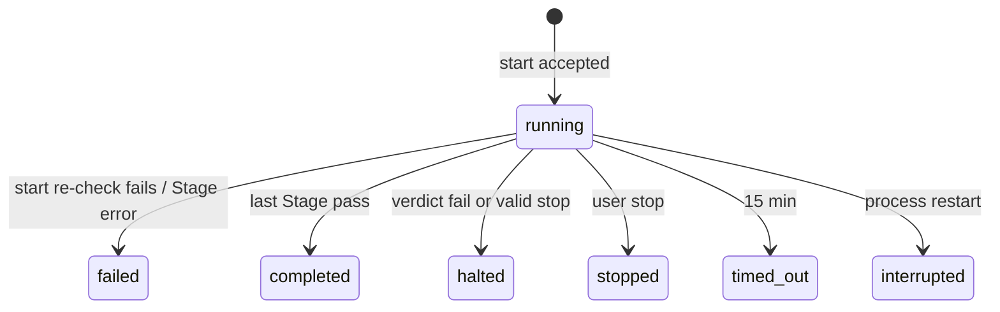

# Design Document: Macro

## Overview

Macro is one Bun 1.4 process (`macro-api`) on the `macro` Vultr VM. It serves the Web_UI, exposes a JSON + Server-Sent Events (SSE) API, calls Vultr Serverless Inference for three agents, and drives Docker through the mounted Docker socket to run each k6 Stage in a gVisor Sandbox behind an in-repo Egress_Proxy. All state lives in one SQLite file (`bun:sqlite`). The Demo_Target (YUE) runs on the `yue-demo` VM.

Everything that decides safety or produces numbers lives in small pure TypeScript modules: Plan_Parser, Plan_Printer, Policy_Gate, Script_Generator, Metrics_Reader, verdict and capacity math, Number_Guard, decision application, and limit math. Those modules carry the property-based tests. Docker, inference, Turnstile, and the UI are thin I/O shells covered by example, integration, and smoke tests.

Scope for tonight: build exactly the Core requirements (1–15). Requirements 16 and 17 get extension points only.

### Settled stack

| Concern | Choice |
|---|---|
| Runtime | Bun 1.4, TypeScript, one process |
| Schemas | `zod` v4 (`z.strictObject`, `z.int()`, `z.toJSONSchema`) |
| Store | `bun:sqlite`, WAL mode, file `/var/lib/macro/macro.db` |
| Tests | `bun test` + `fast-check` |
| Web_UI | `web/index.html`, `web/app.ts` (bundled by `Bun.build` during the image build), `web/style.css`, inline SVG chart, SSE |
| LLM | `POST {VULTR_INFERENCE_BASE_URL}/chat/completions` with `tools` and `tool_choice` forcing the agent's tool |
| Sandbox | Docker Engine API over `/var/run/docker.sock` via Bun `fetch(url, { unix })`; image `grafana/k6@sha256:<digest>`; runtime `runsc` |
| Egress_Proxy | In-repo Bun HTTP CONNECT proxy (`proxy/proxy.ts`), one container per Run |
| Edge | Caddy on both VMs; Cloudflare proxied for `macro.my.id`, DNS-only for the two YUE hosts |

### Research findings that shape the design

- k6 honors the `HTTPS_PROXY` and `HTTP_PROXY` environment variables for its HTTP client ([Grafana community: HTTPS_PROXY](https://community.grafana.com/t/does-k6-not-send-proxy-header/99088), [Grafana community: NO_PROXY](https://community.grafana.com/t/noproxy-option-for-k6/98376/2)). The Sandbox needs only the proxy address in its environment.
- k6 puts tagged sub-metrics into the end-of-test summary (and `handleSummary()` data) only when a threshold is defined on them ([Grafana community](https://community.grafana.com/t/is-there-a-way-to-view-duration-for-each-group-without-having-to-define-thresholds/99715/3)). The Script_Generator emits always-true thresholds per route ID. `handleSummary()` can write the summary JSON to a file ([k6 custom summary docs](https://archive.grafana.com/docs/k6/latest/results-output/end-of-test/custom-summary/)). The first sandbox test must confirm the summary shape for the pinned k6 digest, because k6 1.x changed summary modes.
- `http_req_failed` counts every response outside 200–399, including status 0 (transport error or timeout). With a 10 s request timeout this equals Request_Error (Requirement 7.3).
- Vultr Firewall groups filter inbound traffic only, so egress control is a Docker `--internal` network plus the Egress_Proxy.
- YUE facts from its code: NestJS on Fastify, prefix `/api/v1`, responses wrapped in `{statusCode,message,data}`. Rate limits: `@fastify/rate-limit` 100/min hard-coded in `apps/api/src/bootstrap.ts`, `@nestjs/throttler` global (`THROTTLE_LIMIT`, default 60/min), `@Throttle` 10/min on `POST /orders` and 30/min on `GET /orders/public`. Product IDs are slugs such as `fgo-1`. Products have no stock field, so Requirement 14.7 is N/A once that is confirmed on the seeded data.

### Capacity caution

Both VMs are 1 vCPU / 2 GB with swap. One k6 Sandbox capped at 1 core, doing TLS through a proxy on the same VM, will saturate the load generator well before 500 VUs. Example plans and the Planner_Agent prompt suggest moderate Stages (for example 25 → 50 → 100 → 200 VUs, 60 s each, think time 500–2,000 ms). If time allows, the Sandbox_Runner samples `GET /containers/{id}/stats?stream=false` every 5 s and flags a Stage `generatorSaturated` when mean CPU is at or above 90 % of one core. The Capacity_Report then shows a caution line ("load generator was CPU-bound; latency may include generator delay"). The README states the same limit.

### Requirements tension to confirm

Requirement 2.9 (reject submissions when `VULTR_INFERENCE_API_KEY` is empty) and Requirement 15.9 (exit at startup when a required secret is missing) overlap. With 15.9 the process exits first, so the 2.9 check is a defensive guard inside the planning handler, covered by a unit test that builds the handler with an empty key. No dev-mode flag is added.

## Architecture



### Run sequence



### Run status state machine



### Process and trust boundaries

- Only `macro-api` mounts the Docker socket. This makes `macro-api` root-equivalent on the VM, so it accepts no request that names an image, a mount, a network, or a command; every Docker call uses fixed values from code.
- Sandboxes get no socket, no secret, no route out except the Egress_Proxy.
- The Egress_Proxy container runs Macro code with `runc`, read-only rootfs, all capabilities dropped. It sits on the per-Run internal network and on the `macro-egress` bridge.
- All LLM output, k6 output, proxy log host strings, and Demo_Target responses are Untrusted_Data. They are validated with zod and rendered with `textContent` only.
- `macro-api` listens on `127.0.0.1:3000` inside the Compose network and is reachable only through Caddy. The Vultr firewall group for `macro` allows inbound 80/443 only from Cloudflare IP ranges and 22 from the owner, so `CF-Connecting-IP` cannot be spoofed by direct hits (Requirement 9.10).

### Repository layout (`c:\Users\bayue\Documents\projects\macro\`)

```
src/
  config.ts              env loader + startup checks
  server.ts              Bun.serve routes, static files, SSE
  plan/catalog.ts        Route_Catalog, product IDs, origin roles
  plan/json-strict.ts    strict JSON parser (dup keys, offsets, number lexemes)
  plan/schema.ts         zod Test_Plan schema
  plan/parser.ts         Plan_Parser (fence handling, 16 KiB cap)
  plan/printer.ts        Plan_Printer, planHash
  plan/policy.ts         Policy_Gate
  k6/script.ts           Script_Generator
  k6/probe.js            Containment_Probe (fixed, hand-written)
  k6/metrics.ts          Metrics_Reader
  run/format.ts          rounding and display formatting
  run/verdict.ts         Stage_Verdict, Safe_Capacity, Breaking_Point, First_Degraded_Route
  run/decide.ts          applyDecision (pure)
  run/limits.ts          rolling and daily limit math (pure)
  run/controller.ts      Run_Controller
  sandbox/docker.ts      Engine API client (unix socket fetch, log demux)
  sandbox/runner.ts      Sandbox_Runner
  agents/inference.ts    Inference_Client (primary + fallback)
  agents/planner.ts      Planner_Agent
  agents/supervisor.ts   Supervisor_Agent
  agents/reporter.ts     Report_Writer
  report/number-guard.ts Number_Guard
  report/build.ts        Capacity_Report builder, Allowed_Numbers, comparison
  store/db.ts            Run_Store (schema + queries)
  security/turnstile.ts  Siteverify client
  security/client-ip.ts  CF-Connecting-IP extraction
proxy/proxy.ts           Egress_Proxy
proxy/ip.ts              blocked-address classification (pure)
proxy/Dockerfile
web/index.html, web/app.ts, web/style.css
test/*.test.ts
deploy/macro/docker-compose.yml, deploy/macro/Caddyfile
deploy/yue-demo/Caddyfile, deploy/yue-demo/rate-limit-allowlist.patch, deploy/yue-demo/cleanup-orders.sql
Dockerfile, .env.example, README.md
```

`.env` exists in the repo root and is already ignored. Nothing in the build reads it except Docker Compose `env_file`. Never `cat` or commit it.

## Components and Interfaces

### Config (`src/config.ts`)

Reads `process.env` once at startup into a frozen `Config`.

| Setting | Default | Notes |
|---|---|---|
| `VULTR_INFERENCE_API_KEY` | none, required | Alias: `AI_API_KEY` (the local `.env` uses this name) |
| `VULTR_INFERENCE_BASE_URL` | `https://api.vultrinference.com/v1` | |
| `VULTR_INFERENCE_MODEL` | `minimax-m3.1-flash` | |
| `VULTR_INFERENCE_FALLBACK_MODEL` | `mimo-v2.6-flash` | |
| `TURNSTILE_SECRET_KEY` | none, required | Local dev can use Cloudflare's always-pass test secret |
| `TURNSTILE_SITE_KEY` | none, required | Public; served to Web_UI |
| `TARGET_ORIGINS` | `https://yue.macro.my.id,https://api.yue.macro.my.id` | First entry = web role, second = api role |
| `SANDBOX_RUNTIME` | `runsc` | `runsc` or `runc` |
| `K6_IMAGE` | `grafana/k6@sha256:<pinned>` | Must contain `@sha256:`; startup fails otherwise |
| `MACRO_VM_IP` | `45.77.37.116` | Added to the proxy's blocked-IP list |
| `DATA_DIR` | `/var/lib/macro` | Same path on host and in container (bind mounts use host paths) |
| `VULTR_API_KEY` | unset | Requirement 17 only |

Startup order (Requirement 15.9, 6.11–6.13): load config → exit with the setting name if a required secret is empty → open DB → `GET /info` and check `Runtimes` contains `runsc` when selected (otherwise set `runtimeError`, which makes every start return the Requirement 6.13 error) → remove every container and network labeled `macro=1` → mark `running` Runs `interrupted` → ensure the `macro-egress` network and proxy image exist → start listening.

### Route_Catalog (`src/plan/catalog.ts`)

```ts
type RouteId = 'store_home'|'catalog_list'|'product_detail'|'ledger'|'order_create'|'health';
interface RouteEntry { id: RouteId; role: 'web'|'api'; method: 'GET'|'POST'; path: string; body?: 'order' }
export const ROUTE_CATALOG: readonly RouteEntry[];          // order = tie-break order
export const PRODUCT_IDS: readonly string[];                // ≥5 seeded slugs, set after seeding yue-demo
export const ORDER_PRODUCT_ID: string;                      // one of PRODUCT_IDS
```

`product_detail` picks `PRODUCT_IDS[(__VU + __ITER) % n]`. The `order_create` body is fixed: `productId: ORDER_PRODUCT_ID`, `qty: 1`, `customer: "Macro Load Test"`, `notes: "macro run <runId>"`, and fixed `gameUid`, `contactId`, `chatChannel` values. The body is checked against YUE's `@yue/validators` `createOrderSchema` once during setup, and a unit test pins the literal body.

### Strict JSON (`src/plan/json-strict.ts`)

A small recursive-descent parser (about 120 lines), needed because `JSON.parse` silently keeps the last duplicate key and turns `5.0` into `5`.

```ts
type StrictResult =
  | { ok: true; value: unknown; nonIntegerLexemes: Set<string>; spans: Map<string,[number,number]> }
  | { ok: false; offset: number; reason: string; path?: string };
export function parseStrict(text: string): StrictResult;
```

- Rejects duplicate keys in one object with the field path.
- Records the path of every number whose lexeme contains `.`, `e`, or `E`.
- Records source spans of each value by path, so the Planner can hand the exact `plan` slice of Tool_Call arguments to the Plan_Parser.

### Plan_Parser and Plan_Printer (`src/plan/parser.ts`, `src/plan/printer.ts`)

Test_Plan JSON shape:

```json
{
  "name": "Uma banner night",
  "target": "https://yue.macro.my.id",
  "stages": [{ "vus": 25, "durationSec": 60 }, { "vus": 50, "durationSec": 60 }],
  "journey": [{ "route": "store_home", "probability": 100, "thinkMs": 1000 }],
  "stopThresholds": { "p95Ms": 1500, "errorRatePct": 5 }
}
```

```ts
export function parsePlan(text: string):
  { ok: true; plan: TestPlan } | { ok: false; errors: ParseError[] };
interface ParseError { reason: string; path?: string; offset?: number }
export function printPlan(plan: TestPlan): string;     // canonical JSON
export function planHash(text: string): string;        // sha256 hex of UTF-8 bytes
```

`parsePlan` steps:

1. If `Buffer.byteLength(text, 'utf8') > 16384`, return a size error (measured before fence handling, Requirement 3.3).
2. Fence handling: if the trimmed text starts with `{`, parse it as is. Otherwise find the first line-start "```" (optional `json` tag); if found, take the content up to the next "```"; if there is no closing fence, return "code fence is unclosed" (3.5). If there is no fence, parse the whole text. The `{` check keeps round trips safe when a plan name contains three backticks.
3. `parseStrict` → on failure return offset or path.
4. zod `TestPlanSchema` (strict objects, `z.int()` for `vus`, `durationSec`, `probability`, `thinkMs`, `p95Ms`; `z.number()` finite for `errorRatePct`; `z.string()` for `name`, `target`, `route`). Issues map to `{ reason, path }` with paths like `stages[2].vus`.
5. For each integer field path present in `nonIntegerLexemes`, add an error ("integer required").
6. Normalize `-0` to `0`.

Out-of-policy values with correct types parse successfully (3.2).

`printPlan` writes objects with keys sorted by code point at every level, arrays in order, strings via `JSON.stringify`, numbers via `JSON.stringify` (safe integers never use an exponent), and no whitespace.

### Policy_Gate (`src/plan/policy.ts`)

```ts
interface Violation { rule: '4.2'|'4.3'|'4.4'|'4.5'|'4.6'; path: string; message: string }
type GateResult = { status: 'accepted' } | { status: 'rejected'; violations: Violation[] };
export function evaluatePlan(plan: TestPlan, allowlist: readonly Origin[]): GateResult;
```

Pure, synchronous, no I/O. Rules run in fixed order 4.2 → 4.6, and within a rule in field order, collecting all violations.

- 4.2: `target` must parse with `new URL`, have no userinfo, path `/` or empty, no query or fragment, and match an allowlist origin exactly on protocol, lowercase hostname, and effective port (443 when empty). Denylist (host lowercased): `yueshop.xyz`, `*.yueshop.xyz`, `macro.my.id`, any IPv4 literal, any bracketed IPv6 literal. The denylist applies even when the origin is allowlisted.
- 4.3: one violation per Journey step whose `route` is not a catalog ID.
- 4.4: Stage count 1–6; each `vus` 1–500; each `durationSec` 30–180; sum of durations ≤ 600; `vus` strictly increasing.
- 4.5: Journey length 1–8; each `probability` 1–100; each `thinkMs` 0–10,000; at most one `order_create`; `order_create` probability ≤ 25.
- 4.6: `p95Ms` 100–5,000; `errorRatePct` 0.1–20.

### Script_Generator (`src/k6/script.ts`)

```ts
export function generateStageScript(input: {
  stage: { vus: number; durationSec: number };
  journey: readonly { route: RouteId; probability: number; thinkMs: number }[];
  origins: { web: string; api: string };
  runId: string;               // Macro-generated UUID, needed by Requirement 14.8
}): string;
```

The template is a fixed string with one injection point: `const CFG = <JSON.stringify(cfg)>;`. `cfg` holds only numbers, catalog route entries looked up by ID, the two configured origins, product IDs, and the run ID. It never contains the plan name, the target string from the plan, the rationale, or the Stop_Thresholds. The caller passes only Policy_Gate-accepted values.

Template behavior:

- `options = { scenarios: { stage: { executor: 'constant-vus', vus, duration: '<n>s' } }, summaryTrendStats: ['med','p(95)','p(99)'], thresholds: {...} }`
- For each distinct route ID in the Journey, always-true thresholds `http_req_duration{route:X}: ['max>=0']`, `http_reqs{route:X}: ['count>=0']`, `http_req_failed{route:X}: ['rate>=0']`, `macro_429{route:X}: ['count>=0']`.
- Each request: `http.request(method, url, body, { timeout: '10s', tags: { route }, headers })`, then `macro_429.add(res.status === 429 ? 1 : 0, { route })`.
- Default function: for each step, `if (Math.random() * 100 < probability)` send the request; then `sleep(thinkMs / 1000)` whether or not the step ran.
- `handleSummary(data)` returns `{ '/out/summary.json': JSON.stringify(data) }`.
- k6 is started with `k6 run --no-usage-report --quiet /script/stage.js` so it makes no usage-report call (which would show up as an "egress blocked" event).

### Sandbox_Runner (`src/sandbox/runner.ts`, `src/sandbox/docker.ts`)

Docker client: `fetch('http://docker/v1.47/...', { unix: '/var/run/docker.sock' })`, plus a demux function for the 8-byte-header log stream format.

```ts
interface StageRunResult {
  outcome: 'exited' | 'time_cap' | 'memory_cap' | 'killed_by_stop' | 'create_failed';
  summaryJson?: string;           // contents of out/summary.json, ≤ 5 MiB
  logs?: string;                  // demuxed stdout, probe only
}
openRunNetwork(runId): Promise<RunNet>                  // network + proxy
runSandbox(runNet, spec, signal): Promise<StageRunResult>
closeRunNetwork(runId): Promise<void>                   // remove labeled containers, proxy, network
cleanupAll(): Promise<void>                             // startup sweep
```

Per Run:

1. `POST /networks/create` `{ Name: 'macro-run-<id>', Internal: true, Labels: { macro: '1', 'macro.run': id } }`.
2. Create the proxy container `macro-proxy-<id>` (image `macro-proxy`, `runc`, read-only, `CapDrop: ALL`, `no-new-privileges`, 128 MiB, labels) on the internal network; connect it to `macro-egress`; bind-mount `DATA_DIR/runs/<id>/proxy/` for `denials.jsonl`; pass `ALLOW_HOSTS`, `BLOCK_IPS`. Read its internal-network IP from inspect.
3. If any step fails, remove what was created, mark the Stage `error` (6.16).

Per Stage:

1. Write `DATA_DIR/runs/<id>/stage-<n>/stage.js` (mode 0444) and create `out/` owned by uid 12345.
2. `POST /containers/create` with:
   - `Image: K6_IMAGE`, `User: '12345:12345'`, `Cmd: ['run','--no-usage-report','--quiet','/script/stage.js']`
   - `Env: ['HTTPS_PROXY=http://<proxyIp>:3128', 'HTTP_PROXY=http://<proxyIp>:3128']` (both carry the same Egress_Proxy address; nothing else)
   - `Labels: { macro: '1', 'macro.run': id, 'macro.stage': n }`
   - `HostConfig: { Runtime, ReadonlyRootfs: true, CapDrop: ['ALL'], SecurityOpt: ['no-new-privileges'], PidsLimit: 256, Memory: 1 GiB, MemorySwap: 1 GiB, NanoCpus: 1e9, NetworkMode: 'macro-run-<id>', Binds: ['<stage.js>:/script/stage.js:ro', '<out>:/out:rw'], Tmpfs: { '/tmp': 'size=16m' } }`
   Record "Sandbox created".
3. Start; arm a timer for `durationSec + 30` s (probe: 60 s). On expiry: `POST /containers/{id}/kill`, record "time cap hit" then "Sandbox killed".
4. `POST /containers/{id}/wait` → inspect → `State.OOMKilled` true (or exit 137 without a Macro kill) gives "memory cap hit".
5. Read `out/summary.json`; for the probe, read and demux logs.
6. `DELETE /containers/{id}?force=true`, delete the stage directory, poll `GET /containers/{id}/json` until 404, then record "Sandbox removed".

Egress-denial events: while a Run is open, the runner polls `denials.jsonl` every 1 s from the last byte offset, parses each line with zod (`{ ts, host, port }`, host cut to 255 chars), and records "egress blocked" with the current Stage index.

Run end (any status): `closeRunNetwork` removes all `macro.run=<id>` containers, the proxy, and the network, finishing within 30 s (6.10).

### Egress_Proxy (`proxy/proxy.ts`, `proxy/ip.ts`)

`Bun.listen` TCP server on port 3128.

- `CONNECT host:port`: allow only when `host` (lowercased) is in `ALLOW_HOSTS` and `port === 443`. Resolve with `dns.lookup(host, { all: true })`; drop any address for which `isBlockedIp(addr)` is true; if none remain, deny. Connect to the first allowed IP (no second lookup, so DNS rebinding cannot swap the address), reply `200 Connection Established`, and pipe both ways.
- Any other method (plain HTTP proxying, CONNECT to another port or host): reply `403` with header `X-Macro-Proxy: denied` and close.
- Every denial appends `{"ts":...,"host":...,"port":...,"reason":...}` to `denials.jsonl`.
- `isBlockedIp` covers `0.0.0.0/8`, `10.0.0.0/8`, `100.64.0.0/10`, `127.0.0.0/8`, `169.254.0.0/16` (includes `169.254.169.254`), `172.16.0.0/12`, `192.168.0.0/16`, multicast and reserved ranges, IPv6 `::1`, `fc00::/7`, `fe80::/10`, IPv4-mapped IPv6 of any blocked IPv4, and every IP in `BLOCK_IPS` (`MACRO_VM_IP`).

### Metrics_Reader (`src/k6/metrics.ts`)

```ts
export function readSummary(json: string | undefined, routes: readonly RouteId[]):
  { ok: true; metrics: StageMetrics } | { ok: false; reason: string };
```

- Overall: `http_reqs.values.count`, `http_req_duration.values['med'|'p(95)'|'p(99)']`, `http_req_failed.values.rate × 100`, `macro_429.values.count` (absent → 0), `rps = count / (state.testRunDurationMs / 1000)`.
- Per route: the same values from `metric{route:X}` sub-metrics; routes with absent or zero count are omitted.
- Error cases (7.2): missing text, invalid JSON, missing required overall value, overall count 0, any required value not a finite number ≥ 0, `testRunDurationMs` not > 0.
- The summary is Untrusted_Data; the reader validates it with zod `passthrough` objects and reads nothing else.

### Formatting and capacity math (`src/run/format.ts`, `src/run/verdict.ts`)

```ts
roundHalfAway(x: number, decimals: 0|1): number    // uses Number(x.toPrecision(15)) before scaling
fmtMs(x) → "123"; fmtPct(x) → "12.3"; fmtRps(x) → "45.6"
stageVerdict(m: StageMetrics, t: StopThresholds): 'pass'|'fail'
  // roundHalfAway(m.p95,0) <= t.p95Ms && roundHalfAway(m.errorRatePct,1) <= t.errorRatePct
safeCapacity(stages: StageResult[]): number | null
breakingPoint(stages: StageResult[]): number | null
firstDegradedRoute(stages: StageResult[], t: StopThresholds): RouteId | null
  // earliest Stage with any route over either threshold (same rounding);
  // within it, highest rounded p95; ties broken by ROUTE_CATALOG order
```

`StageResult` lists only Stages with Stage_Metrics, in Stage order.

### Run_Controller (`src/run/controller.ts`, `src/run/decide.ts`)

```ts
type AgentDecision = { decision: 'continue'|'stop'; reason: string } | null;  // null = no valid decision
type Applied =
  | { kind: 'end'; status: 'completed'|'halted' }                                      // last Stage
  | { kind: 'decision'; applied: 'continue'|'stop'; source: 'agent'|'fallback';
      reasonKind: 'agent'|'no_valid_decision'|'fail_override'; endStatus?: 'halted' };
export function applyDecision(isLast: boolean, verdict: 'pass'|'fail', agent: AgentDecision): Applied;
```

Rules:

- Last Stage: `pass` → `completed`, `fail` → `halted`; no Supervisor call, no decision record.
- Otherwise `applied = verdict === 'fail' ? 'stop' : (agent?.decision ?? 'continue')`; `source = agent?.decision === applied ? 'agent' : 'fallback'`; `reasonKind` is `agent` for source `agent`, `fail_override` when `agent?.decision === 'continue'` and verdict `fail`, else `no_valid_decision`; `stop` ends the Run `halted`.

Controller loop for a Run (one async task, one `AbortController`):

1. Re-read the stored plan text, check `sha256 === planHash`, `parsePlan`, `evaluatePlan`; on failure set `failed` with the reason (5.4, 5.7).
2. Open the run network. For each Stage: generate script → `runSandbox` → on `error` outcomes set `failed` (7.6) → `readSummary` → `stageVerdict` → store metrics and verdict → if not last, call the Supervisor (15 s per model attempt, 30 s overall) → after the await, if status is no longer `running`, discard (8.9) → Number_Guard the reason → `applyDecision` → store the decision → continue or end.
3. On any end: `closeRunNetwork`, set status, build the Capacity_Report for `completed|halted|stopped|timed_out`, launch Report_Writer.

Stop (9.2) and the 15-minute timer (9.3) set the status first, then abort the signal, which kills the current Sandbox. The status is written before the kill so a late Supervisor response is discarded.

### Run slot and limits (`src/run/limits.ts`)

```ts
rollingCheck(timestamps: number[], now: number, limit: number, windowMs: number):
  { ok: true } | { ok: false; retryAt: number }      // counts ts > now - windowMs; retryAt = oldest counted + windowMs
dailyCheck(startedTimestamps: number[], now: number, limit: number):
  { ok: true } | { ok: false; resetAt: number }      // counts ts >= UTC midnight of now; resetAt = next UTC midnight
```

Start admission (Run, re-run, probe) runs inside one synchronous block after Turnstile verification. Bun is single-threaded and `bun:sqlite` is synchronous, so no other request can interleave between the check and the insert (9.9):

1. active slot (`runs.status = 'running'` or `activeProbe` set) → reject naming it (9.1, 12.7)
2. per-IP rolling 6/60 min from `client_starts` (9.5)
3. daily 50 from `runs.started_at` (9.6; survives restart because it is read from SQLite)
4. insert `runs` row with status `running` and a `client_starts` row

Planning limit (9.4): length check (1.4) → Turnstile → `rollingCheck(planning_requests, 10, 60 min)` → insert row → Planner.

### Turnstile and client IP (`src/security/*`)

`verifyTurnstile(token, ip)` posts `secret`, `response`, `remoteip` to `https://challenges.cloudflare.com/turnstile/v0/siteverify` with a 10 s `AbortSignal.timeout`. Any missing token, `success: false`, error, or timeout gives `ok: false` (9.8). The Web_UI calls `turnstile.reset()` after each use, because tokens are single-use and planning, approval, re-run, and probe each need one. `clientIp(req)` returns `CF-Connecting-IP` (Caddy passes it through unchanged).

### Inference_Client (`src/agents/inference.ts`)

```ts
callTool(opts: {
  agent: 'planner'|'supervisor'|'reporter';
  messages: ChatMessage[];
  tool: { name: string; description: string; parameters: JSONSchema };
  timeoutMs: number;                    // per attempt: 45_000 planner/reporter, 15_000 supervisor
  link: { draftId?: string; runId?: string };
}): Promise<{ ok: true; toolCalls: ToolCall[] } | { ok: false; reason: 'error'|'timeout' }>
```

- Body: `{ model, messages, tools: [{ type: 'function', function: tool }], tool_choice: { type: 'function', function: { name } }, temperature: 0.2 }`, header `Authorization: Bearer <key>`.
- Primary attempt; on error response, transport error, or timeout, one identical attempt on the fallback model (2.7).
- Each attempt inserts a `model_calls` row: agent, model, outcome, latency, `usage.prompt_tokens` / `usage.completion_tokens` or null ("not reported").
- The key appears only in the `Authorization` header; error messages returned to the Web_UI are fixed strings, never the upstream body.

### Planner_Agent (`src/agents/planner.ts`)

- Messages: system (instructions, Route_Catalog as a table, Target_Allowlist, Policy_Gate limits from 4.4–4.6, sizing advice for a 1-vCPU generator), then a user message containing only `<traffic_event>…</traffic_event>` with the trimmed text, labeled as untrusted data.
- Tool `propose_plan` with `parameters = { plan: z.toJSONSchema(TestPlanSchema), rationale: string 1–300 }`.
- Take the first `propose_plan` call. Parse its `arguments` with `parseStrict`. If `plan` is a string, pass that string to `parsePlan` (covers fenced output); otherwise pass the source slice of `plan` from `spans`.
- Failure (no tool call, bad rationale, parse errors, gate rejection) → one more request with the original messages plus an assistant echo and a user message listing the errors. After the second failure, return its errors (2.8). Total model attempts ≤ 4.
- Both attempts of one request fail → "planning failed" (2.3).

### Supervisor_Agent and Report_Writer

- Supervisor tool `decide_next_stage { decision: enum, reason: string 1–500 }`. Input: metrics of completed Stages (formatted), Stop_Thresholds, next Stage VUs. Validation in `src/agents/supervisor.ts` takes only the first `decide_next_stage` call and returns `AgentDecision` (null when invalid or past 30 s).
- Report_Writer tool `write_report { explanation: string, suggestions: string[] }`. Input: formatted metrics, Safe_Capacity, Breaking_Point, First_Degraded_Route, Route_Catalog. The builder keeps the first 5 suggestions, cuts the explanation to 1,500 and each suggestion to 300 characters, then runs the Number_Guard (10.13, 10.7–10.8).

### Number_Guard (`src/report/number-guard.ts`)

```ts
export function numericTokens(text: string): number[];
export function guardText(text: string, allowed: ReadonlySet<number>): { pass: boolean; bad: number[] };
export function allowedNumbers(run: RunView): Set<number>;
```

Tokenizer:

1. `text.normalize('NFKC')` so full-width digits become ASCII.
2. Find maximal runs matching `[0-9][0-9.,]*` not preceded by a letter (`\p{L}`), digit, `_`, `.` or `,`; strip trailing `.` and `,`.
3. If the run matches `^\d{1,3}(,\d{3})+(\.\d+)?$` or `^\d+(\.\d+)?$`, it is one token (commas removed). Otherwise split it on `.` and `,` and treat every part as its own token. Splitting only adds tokens, so malformed grouping can never hide a number.

`allowedNumbers` holds the formatted Stage_Metrics values (latency integers, rate and rps at one decimal, request counts, 429 counts), every Stage VU count, duration, and 1-based index from the plan, the Stop_Thresholds values, Safe_Capacity and Breaking_Point when present, and 0–10. Comparison is by numeric value.

Replacement templates (no LLM numbers): explanation → "Safe capacity: {SC or 'none found'} VUs. Breaking point: {BP or 'not reached'}. First degraded route: {route or 'none'}."; Supervisor reason → "Decision: {decision}. Stage verdict: {verdict}." Each replacement is shown with the label "AI explanation withheld: unverified number".

### Capacity_Report builder and comparison (`src/report/build.ts`)

`buildReport(run)` computes headline values, Stage table, per-route tables, decisions, and Containment_Events only from stored metrics and plan values (10.6). States for 10.3, 10.4, 10.11, 10.12 are explicit fields (`breakingPoint: null` plus `highestVus`, and so on) that the UI renders as the required sentences.

`compareRuns(a, b)` returns `{ error: 'different_plan' }` for different Plan_Hashes. Otherwise it picks the earlier-started Run as baseline and computes rows for overall and per-route p95, error rate, and rps. Differences use the displayed (rounded) values, so the visible arithmetic adds up. Percent change is `(later − base) / base × 100` at one decimal, `n/a` when a side lacks the value or base is 0; a Stage or route present on one side only is marked `not run`.

### Containment_Probe (`src/k6/probe.js`)

Fixed k6 script, 1 VU, 1 iteration, run through the same `runSandbox` path with its own Run ID, network, and proxy, Stage index 1, 60 s cap. Each action prints one line `MACRO_PROBE {"action":"a","result":...}` with `console.log`, because the memory action kills the process before `handleSummary` could run.

| Action | Attempt | `contained` when |
|---|---|---|
| a | `GET https://example.com/` | `status === 0` or header `X-Macro-Proxy: denied` |
| b | `GET http://169.254.169.254/latest/meta-data/` | same |
| c | `GET https://macro.my.id/healthz` | same |
| d | names of `__ENV` matching `/KEY|SECRET|TOKEN/i` | no match (values never printed) |
| e | grow an array of 16 MiB `ArrayBuffer`s up to 1.5 GiB | Docker reports OOM and "memory cap hit" is recorded |

The runner parses the demuxed log lines with zod after exit. Actions a–d with no line are `no result`; action e is decided from Docker state only. Result: `passed` if all five are `contained`, `failed` (naming escaped actions) if any is `escaped`, otherwise `incomplete`.

### HTTP API (`src/server.ts`)

| Method and path | Purpose | Turnstile |
|---|---|---|
| `GET /` and static assets | Web_UI | no |
| `GET /api/config` | web origin, site key, runtime, examples | no |
| `POST /api/plan` | `{ trafficEvent, turnstileToken }` → draft, gate result, rationale, model calls | yes |
| `POST /api/approve` | `{ planText, turnstileToken }` → `{ runId, planHash }` | yes |
| `POST /api/runs` | `{ planHash, turnstileToken }` re-run | yes |
| `POST /api/runs/:id/stop` | stop | no (9.2) |
| `GET /api/runs/:id` | snapshot: run, stages, decisions, events, report, model calls | no |
| `GET /api/runs/:id/events` | SSE; replays from `Last-Event-ID`; heartbeat every 3 s | no |
| `GET /api/plans/:hash/runs` | 20 newest Runs | no |
| `GET /api/compare?a=&b=` | comparison | no |
| `POST /api/probe` | `{ turnstileToken }` → `{ runId }` | yes |
| `GET /healthz` | liveness | no |

All bodies are parsed with zod; request bodies above 64 KiB are rejected. Responses set `Content-Security-Policy: default-src 'self'; script-src 'self' https://challenges.cloudflare.com; frame-src https://challenges.cloudflare.com; connect-src 'self'; style-src 'self'`.

### Web_UI (`web/`)

One page, hash routes `#/` (describe and plan), `#/run/<id>` (live view and report), `#/probe/<id>`.

- Describe: textarea with code-point counter `[...text.trim()].length` / 1,000, example buttons (fill only), Turnstile widget, submit disabled outside 10–1,000 or while pending (1.1–1.8). Target shown read-only from `/api/config`.
- Plan review: Stages table, Journey table (method and path from a client copy of the catalog served by `/api/config`), thresholds, rationale via `textContent`, approval button stating target, max VUs, total seconds; violation list and no approval button when rejected; model-call list.
- Live run: "Stage N of M", VUs, elapsed `mm:ss` ticking every second, stop button, Stage rows, decisions, Containment_Event timeline (warning icon and amber highlight for egress blocked, memory cap hit, time cap hit), staleness badge after 10 s without an SSE message (heartbeats count). `EventSource` reconnects with `Last-Event-ID`, so the gap is replayed.
- Report: headline values, SVG chart (p95 per Stage with a dashed threshold line, error-rate bars), tables, an "AI-generated" section, Run list, compare picker, re-run with `confirm()`.
- Probe: start button, five action rows, events, runtime, result.

All untrusted strings are set with `textContent`; the app never uses `innerHTML` with data.

### Deployment

`macro` VM:

- Install gVisor (`runsc` apt package, `runsc install`, restart Docker) so `/etc/docker/daemon.json` registers `runsc`.
- `deploy/macro/docker-compose.yml`: `caddy` (ports 80/443, Cloudflare Origin CA cert and key mounted from `/etc/macro/tls/`, outside the repo) and `macro-api` (build from `Dockerfile`, `env_file: ../../.env`, volumes `/var/run/docker.sock`, `/var/lib/macro:/var/lib/macro`). The `macro-proxy` image is built by the same Compose file under a `build-only` profile and referenced by tag. Cloudflare SSL mode: Full (strict).
- One command: `docker compose -f deploy/macro/docker-compose.yml up -d --build` (15.2).

`yue-demo` VM:

- `/opt/yue` with its own docker-compose (Postgres, Redis, API, web) plus Caddy for `yue.macro.my.id` and `api.yue.macro.my.id` (Let's Encrypt, DNS-only records to 45.32.113.74).
- `.env` for YUE with demo-only values: local Postgres and Redis URLs, empty `DISCORD_WEBHOOK_URL`, `WHATSAPP_WEBHOOK_URL`, Kafka and S3 settings, `RATE_LIMIT_ALLOWLIST=45.77.37.116`.
- Patch `deploy/yue-demo/rate-limit-allowlist.patch`, applied locally and never committed to YUE: `@fastify/rate-limit` `allowList` from `RATE_LIMIT_ALLOWLIST`; a `ThrottlerGuard` subclass whose `shouldSkip` returns true for those IPs (this also covers the per-route `@Throttle` limits); Fastify `trustProxy` set to Caddy's address so `request.ip` is the real client IP.
- Seed at least 5 products; copy their slugs into `PRODUCT_IDS`.
- `cleanup-orders.sql` deletes orders where customer is `Macro Load Test` (run by hand between demo runs).

### Extension points (Optional)

- Requirement 16: `buildReport` output already carries everything; an `exportMarkdown(report)` pure function would escape AI text (backslash-escape Markdown control characters and `<`), and `GET /r/:id` would render a read-only page from the same view model.
- Requirement 17: `runSandbox` sits behind a `StageExecutor` interface (`run(stageSpec, signal) → StageRunResult`). A `VultrRegionExecutor` would implement it with the Vultr API, a per-Stage results token, and a sweeper. Not built tonight.

## Data Models

### TypeScript types

```ts
interface TestPlan {
  name: string;
  target: string;
  stages: { vus: number; durationSec: number }[];
  journey: { route: string; probability: number; thinkMs: number }[];
  stopThresholds: { p95Ms: number; errorRatePct: number };
}
interface Metrics {                       // one overall or one per-route block
  requests: number; rps: number; errorRatePct: number; http429: number;
  p50: number; p95: number; p99: number;  // ms, unrounded
}
interface StageMetrics { overall: Metrics; routes: Partial<Record<RouteId, Metrics>> }
type StageStatus = 'running' | 'done' | 'error';
interface StageResult { index: number; vus: number; durationSec: number; metrics: StageMetrics; verdict: 'pass'|'fail' }
type RunStatus = 'running'|'completed'|'halted'|'stopped'|'timed_out'|'failed'|'interrupted';
type ContainmentType = 'sandbox_created'|'egress_blocked'|'memory_cap_hit'|'time_cap_hit'
                     |'sandbox_killed'|'sandbox_removed'|'runner_created'|'runner_deleted';
```

### SQLite schema (`src/store/db.ts`)

```sql
CREATE TABLE drafts (id TEXT PRIMARY KEY, traffic_event TEXT NOT NULL, created_at INTEGER NOT NULL);
CREATE TABLE plans (hash TEXT PRIMARY KEY, text TEXT NOT NULL, approved_at INTEGER NOT NULL);
CREATE TABLE runs (
  id TEXT PRIMARY KEY, kind TEXT NOT NULL CHECK (kind IN ('run','probe')),
  plan_hash TEXT REFERENCES plans(hash), status TEXT NOT NULL, status_reason TEXT,
  runtime TEXT NOT NULL, started_at INTEGER NOT NULL, ended_at INTEGER,
  probe_result TEXT                                   -- JSON, probe only
);
CREATE INDEX runs_plan ON runs(plan_hash, started_at DESC);
CREATE INDEX runs_started ON runs(started_at);
CREATE TABLE stages (
  run_id TEXT NOT NULL, idx INTEGER NOT NULL, vus INTEGER NOT NULL, duration_sec INTEGER NOT NULL,
  status TEXT NOT NULL, error_reason TEXT, metrics TEXT, verdict TEXT,
  generator_saturated INTEGER, started_at INTEGER, ended_at INTEGER,
  PRIMARY KEY (run_id, idx)
);
CREATE TABLE decisions (
  run_id TEXT NOT NULL, stage_idx INTEGER NOT NULL, decision TEXT NOT NULL,
  source TEXT NOT NULL, reason TEXT NOT NULL, reason_withheld INTEGER NOT NULL,
  PRIMARY KEY (run_id, stage_idx)
);
CREATE TABLE events (                                 -- feeds SSE; id = SSE event id
  id INTEGER PRIMARY KEY AUTOINCREMENT, run_id TEXT NOT NULL, type TEXT NOT NULL,
  stage_idx INTEGER, payload TEXT, ts INTEGER NOT NULL
);
CREATE INDEX events_run ON events(run_id, id);
CREATE TABLE reports (run_id TEXT PRIMARY KEY, body TEXT NOT NULL, ai TEXT, ai_status TEXT NOT NULL);
CREATE TABLE model_calls (
  id INTEGER PRIMARY KEY AUTOINCREMENT, draft_id TEXT, run_id TEXT, agent TEXT NOT NULL,
  model TEXT NOT NULL, outcome TEXT NOT NULL, latency_ms INTEGER NOT NULL,
  prompt_tokens INTEGER, completion_tokens INTEGER, ts INTEGER NOT NULL
);
CREATE TABLE planning_requests (ip TEXT NOT NULL, ts INTEGER NOT NULL);
CREATE TABLE client_starts (ip TEXT NOT NULL, ts INTEGER NOT NULL);
```

`events.type` values: `stage_start`, `stage_end`, `decision`, `status`, `containment`, `report`. Containment events carry `{ type: ContainmentType, host?, port? }`. Rows in `planning_requests` and `client_starts` older than 24 h are deleted hourly. Neither the inference key nor any secret is ever written to the database.

## Correctness Properties

*A property is a characteristic or behavior that should hold true across all valid executions of a system-essentially, a formal statement about what the system should do. Properties serve as the bridge between human-readable specifications and machine-verifiable correctness guarantees.*

The reflection step removed overlaps from the prework: 3.1 and 3.2 fold into the round trip; 4.2–4.6 fold into one model-based gate property; 7.5, 10.3, 10.4, and 10.11 fold into one capacity-math property; 8.2–8.4, 8.7, and 8.8 fold into one decision property; 2.6 and 2.7 fold into the planner attempt property; 12.4, 12.5, and 12.9 fold into one probe-classification property; 13.3–13.5 fold into one comparison property. UI, Docker, deployment, and README criteria are covered by example, integration, and smoke tests instead.

### Property 1: Plan round trip

For any type-correct Test_Plan structure (including out-of-policy values, Unicode names, and names containing three backticks), `parsePlan(printPlan(p))` succeeds and equals `p`, and `printPlan` of that result is byte-identical to the first print.

**Validates: Requirements 3.1, 3.2, 3.7**

### Property 2: Canonical print format

For any Test_Plan structure, `printPlan` output has object keys sorted by code point at every nesting level, contains no whitespace outside string values, prints every integer field without `.`, `e`, or `E`, and preserves Stage and Journey order.

**Validates: Requirements 3.6**

### Property 3: Malformed plan text is rejected with a located error

For any valid plan text and any single mutation from {drop a required field, add an unknown field, duplicate a key, replace an integer with a fractional or exponent lexeme, change a value's type, truncate to invalid JSON, pad past 16,384 UTF-8 bytes}, `parsePlan` returns no structure and an error whose reason matches the mutation and whose path (with array indexes) or offset points at the mutated location.

**Validates: Requirements 3.3**

### Property 4: Fence extraction

For any valid plan text and any prefix and suffix text that contain no backticks and whose prefix does not start with `{`, parsing the text wrapped as prefix + "```json\n" + plan + "\n```" + suffix (with or without the `json` tag) yields the same structure as parsing the plan text alone, and removing the closing fence yields the "code fence is unclosed" error.

**Validates: Requirements 3.4, 3.5**

### Property 5: Policy_Gate matches a reference rule model

For any Test_Plan structure drawn from a generator that biases values toward each bound (0, 1, 500, 501 VUs; 29, 30, 180, 181 s; duration sums around 600; probabilities 0, 1, 25, 26, 100, 101; think times around 0 and 10,000; thresholds around 100, 5,000, 0.1, 20; target origins that are allowlisted, case or port variants, with paths, denylisted, or IP literals; route IDs inside and outside the catalog), `evaluatePlan` returns `accepted` exactly when an independently written reference checker finds no violation, and otherwise returns the same set of (rule, path) pairs as the reference.

**Validates: Requirements 4.1, 4.2, 4.3, 4.4, 4.5, 4.6**

### Property 6: Policy_Gate is deterministic and offline

For any Test_Plan structure, evaluating it twice, and evaluating a deep clone, returns deeply equal results with violations in the same order, and the `fetch` spy records no call.

**Validates: Requirements 4.7**

### Property 7: Approval stores only canonical, accepted plans

For any plan text, the approval handler (in-memory SQLite, Turnstile and run start mocked) stores a plan row exactly when the text parses and the Policy_Gate accepts it; the stored text equals `printPlan(parsePlan(text))` and its key equals the SHA-256 of that text; approving any re-formatted variant of the same plan keeps a single row; and a rejected text leaves the `plans` and `runs` tables unchanged.

**Validates: Requirements 4.9, 5.2, 5.6**

### Property 8: Unapproved Plan_Hash never starts a Run

For any string that is not 64 lowercase hexadecimal characters, and for any well-formed hash not stored as approved, the start handler returns the "not approved" error, inserts no `runs` row, and calls no Sandbox_Runner function.

**Validates: Requirements 5.5**

### Property 9: Stage scripts contain only approved values

For any Policy_Gate-accepted Test_Plan, any Stage of it, and any name and rationale strings (including script-injection payloads), `generateStageScript` output contains `constant-vus`, the Stage VU count and duration, `timeout: '10s'`, and a route tag for every Journey route ID; it does not contain the plan name; and two plans that differ only in name produce byte-identical scripts.

**Validates: Requirements 6.1**

### Property 10: Egress decision allows only allowlisted hosts on 443 with public addresses

For any host, port, and resolved address list (IPv4, IPv6, and IPv4-mapped IPv6, drawn inside and outside each blocked range and including `169.254.169.254` and `MACRO_VM_IP`), the proxy's connect decision allows the connection exactly when the lowercased host is in `ALLOW_HOSTS`, the port is 443, and at least one resolved address is not blocked, and the chosen address is always a non-blocked one.

**Validates: Requirements 6.15**

### Property 11: Metrics_Reader recovers generated summary values

For any set of non-negative finite metric values and a positive test duration, building a k6-shaped summary from them and reading it with `readSummary` returns the same counts and latencies, an error rate equal to the failed rate × 100, rps equal to count ÷ (duration ÷ 1000), per-route entries exactly for routes with a positive count, and an HTTP 429 count of 0 when the counter is absent.

**Validates: Requirements 7.1**

### Property 12: Metrics_Reader rejects incomplete summaries

For any valid generated summary and any single corruption from {invalid JSON, missing overall count, missing p50, p95, or p99, missing failed rate, overall count 0, a required value that is negative, non-finite, or a string, missing or zero test duration}, `readSummary` returns an error with a reason and no metrics.

**Validates: Requirements 7.2**

### Property 13: Display rounding

For any finite non-negative number x, `fmtMs(x)` is an integer string, `fmtPct(x)` and `fmtRps(x)` have exactly one decimal, each formatted value differs from x by at most half a unit of its last digit, and values exactly halfway between two units (for example 2.5 and 0.25) round away from zero.

**Validates: Requirements 7.4**

### Property 14: Verdict and capacity values match a reference

For any sequence of Stage results with increasing VU counts, random overall and per-route metrics, and random Stop_Thresholds, `stageVerdict`, `safeCapacity`, `breakingPoint`, and `firstDegradedRoute` equal a reference implementation that compares rounded values: Safe_Capacity is the VU count of the last Stage of the leading run of passes (null when the first Stage fails), Breaking_Point is the VU count of the first failing Stage (null when none fails), and First_Degraded_Route is the route over either threshold in the earliest such Stage with the highest rounded p95 and catalog order as tie-break (null when no route exceeds).

**Validates: Requirements 7.5, 10.3, 10.4, 10.11**

### Property 15: Decision application

For any `isLast`, Stage_Verdict, and agent decision (valid `continue`, valid `stop`, or none), `applyDecision` returns: for the last Stage, `completed` on pass and `halted` on fail with no decision record; otherwise an applied decision that is `stop` whenever the verdict is `fail`, equals the agent's decision when the verdict is `pass` and the agent decision is valid, and is `continue` when the verdict is `pass` and there is no valid decision; source `agent` exactly when the applied decision equals the agent's valid decision; and an end status of `halted` exactly when the applied decision is `stop`.

**Validates: Requirements 8.2, 8.3, 8.4, 8.7, 8.8**

### Property 16: Supervisor response validation

For any list of Tool_Calls (random names, duplicate `decide_next_stage` calls, random `decision` strings, reasons of length 0 to 600, malformed argument JSON) and any response delay, the validator returns a decision exactly when the first `decide_next_stage` call has `decision` exactly `continue` or `stop`, a `reason` of 1 to 500 characters, and arrived within 30 s, and the returned decision always comes from that first call.

**Validates: Requirements 8.5, 8.6**

### Property 17: Planner attempt budget

For any sequence of mocked attempt outcomes (success with valid plan, success with no tool call, invalid rationale, unparsable plan, gate-rejected plan, error, timeout), the Planner_Agent makes at most two logical requests and at most four model attempts, falls back to the fallback model with an identical body exactly after a failed primary attempt, includes the first request's errors in the second request, and writes exactly one `model_calls` row per attempt.

**Validates: Requirements 2.2, 2.6, 2.7**

### Property 18: Traffic_Event length gate

For any value (non-string values, and strings built from random code points including astral characters and leading or trailing whitespace), the planning handler calls the Inference_Client exactly when the value is a string whose trimmed code-point length is between 10 and 1,000 inclusive, and otherwise returns the length error.

**Validates: Requirements 1.4**

### Property 19: Rolling and daily limits match a reference

For any set of past timestamps, any `now`, and the configured limits (10 per 60 min for planning, 6 per 60 min for starts, 50 per UTC day), `rollingCheck` and `dailyCheck` reject exactly when the reference count (timestamps in `(now − 60 min, now]`, or since UTC midnight) has reached the limit, and a rejection's `retryAt` equals the oldest counted timestamp + 60 min (or `resetAt` equals the next UTC midnight), which is always later than `now`.

**Validates: Requirements 9.4, 9.5, 9.6**

### Property 20: One active Run under concurrent starts

For any number of concurrent start requests (2 to 20, mixing Run and Containment_Probe starts, with random mocked Turnstile delays), at most one is accepted while none is active, every other request receives the active-Run error, and the store holds at most one `runs` row with status `running`.

**Validates: Requirements 9.1, 9.9**

### Property 21: Number_Guard accepts exactly allowed numbers

For any Allowed_Numbers set and any text assembled from words, punctuation, letter-prefixed digit strings (such as `p95`), and numbers formatted from the allowed set (with or without thousands separators), `guardText` passes; and for any such text with one inserted numeric token whose value is not in the set (including full-width digits and malformed groupings such as `3,4`), `guardText` fails and reports that value.

**Validates: Requirements 10.7**

### Property 22: AI text shown is bounded and verified

For any `write_report` arguments and Supervisor reasons (random lengths, random numbers), the processed output keeps at most 5 suggestions, an explanation of at most 1,500 characters, suggestions of at most 300 characters, and every AI-written or template text it shows passes the Number_Guard against the Run's Allowed_Numbers; each replaced or removed text is marked "AI explanation withheld: unverified number".

**Validates: Requirements 10.8, 10.13**

### Property 23: Report numbers do not depend on AI output

For any Run with stored Stage results and any two different Report_Writer and Supervisor outputs, the Capacity_Report headline values and tables are identical, and every number in them equals a value computed from the stored metrics and the approved plan.

**Validates: Requirements 10.6**

### Property 24: Containment_Probe classification

For any combination of per-action outcomes for actions a–d (contained, escaped, missing line) and any Docker memory-kill state for action e, the classifier marks a missing line as `no result`, returns `failed` naming exactly the escaped actions when any action escaped, returns `passed` exactly when all five are contained, and returns `incomplete` otherwise.

**Validates: Requirements 12.4, 12.5, 12.9**

### Property 25: Run comparison

For any two Runs with random Stage and route coverage and random metrics, `compareRuns` returns `different_plan` when the Plan_Hashes differ; otherwise the earlier-started Run is the baseline, each difference equals later minus baseline on the displayed rounded values, each percent change equals difference ÷ baseline × 100 at one decimal, rows missing a value or with a baseline of 0 show `n/a`, and Stages or routes present on one side only are marked `not run` with no difference.

**Validates: Requirements 13.3, 13.4, 13.5**

## Error Handling

All errors returned to the Web_UI use one shape: `{ error: { code: string, message: string, details?: unknown } }`. Messages are fixed strings or built from Macro values; upstream bodies (Vultr, Docker, Siteverify) are logged server-side with secrets redacted and never returned.

| Situation | Behavior | Requirement |
|---|---|---|
| Traffic_Event missing or out of 10–1,000 | 400 `traffic_event_length`, no Siteverify, no inference | 1.4 |
| Turnstile missing, rejected, error, or > 10 s | 403 `turnstile_failed` "Please complete the verification again"; not counted toward limits | 9.8 |
| Planning limit hit | 429 `planning_limit` with `retryAt` (ISO UTC) | 9.4 |
| Both model attempts fail | 502 `planning_failed`; UI shows retry button | 2.3 |
| Second plan attempt invalid | 422 `plan_invalid` with errors or violations; no approval control | 2.8 |
| Inference key empty | 503 `inference_not_configured` (defensive; startup normally exits) | 2.9, 15.9 |
| Approval of unparsable or rejected plan | 422 with parse errors or violations; nothing stored | 4.9, 5.6 |
| Unknown or malformed Plan_Hash | 404 `plan_not_approved` | 5.5 |
| Active Run or probe | 409 `run_active` with the active Run ID or "probe in progress" | 9.1, 12.7 |
| Per-IP start limit | 429 `start_limit` with `retryAt` | 9.5 |
| Daily limit | 429 `daily_limit` with `resetAt` = next 00:00 UTC | 9.6 |
| Invalid `SANDBOX_RUNTIME` or `runsc` missing | 503 `sandbox_runtime` naming the value or "gVisor is missing; set SANDBOX_RUNTIME=runc explicitly" | 6.13 |
| Stored plan hash mismatch or re-gate failure | Run `failed` with reason; no Sandbox | 5.7 |
| Network, proxy, or container create fails | Stage `error`, created resources removed, Run `failed` | 6.16, 7.6 |
| Time cap | kill; events "time cap hit", "Sandbox killed"; Stage `error`; Run `failed` | 6.7 |
| OOM | event "memory cap hit"; Stage `error`; Run `failed` | 6.8 |
| Summary missing or invalid | Stage `error` with reason; Run `failed`; earlier Stages kept | 7.2, 7.6 |
| Supervisor invalid or late | verdict-only fallback with fixed reason | 8.5 |
| Report_Writer fails | report shown with "AI explanation unavailable" | 10.9 |
| Number_Guard failure | template replacement or removal, labeled | 10.8 |
| Process restart mid-Run | startup sweep removes containers and networks; Runs marked `interrupted` | 6.11 |
| SSE drop | client reconnects with `Last-Event-ID`; staleness badge after 10 s | 11.8 |
| Docker cleanup step fails | retried 3 times with 2 s spacing inside the 30 s budget, then logged; the startup sweep is the backstop | 6.10 |

The Run_Controller wraps each Run in `try/finally` so `closeRunNetwork` always runs. Unexpected exceptions set the Run to `failed` with reason "internal error" and log the stack.

## Testing Strategy

### Approach

- Unit and property tests run with `bun test` on any machine and need no Docker, network, or secrets.
- Property tests use `fast-check`. PBT applies here because the core is pure logic with large input spaces: parsing and printing, rule evaluation, script templating, summary parsing, rounding, capacity math, text guarding, and limit math.
- Each of the 25 correctness properties is implemented by exactly one property-based test, configured with `{ numRuns: 100 }` or more, and tagged with a comment in this format:

```ts
// Feature: macro, Property 1: Plan round trip
test('plan round trip', () => {
  fc.assert(fc.property(arbTestPlan(), (p) => { /* ... */ }), { numRuns: 100 });
});
```

- Shared generators live in `test/arb.ts`: `arbTestPlan` (type-correct, unconstrained), `arbAcceptedPlan` (inside every Policy_Gate bound), `arbBoundaryPlan` (biased to bounds), `arbSummary`, `arbStageResults`, `arbIp`, `arbAllowedText`.
- Reference models (Policy_Gate checker, capacity math, limit counters) are written plainly in the test files, separate from the implementation.

### Unit and example tests

Keep these few and targeted:

- Policy_Gate boundary examples for each inclusive bound (Requirement 4.4–4.6).
- Docker create body for a Stage: exact `HostConfig` hardening fields, exact `Env` list, labels, pinned image (6.2–6.4, 6.12).
- Sandbox_Runner with a fake Docker client: time cap sequence, OOM detection, "Sandbox removed" only after a 404, creation failure cleanup, startup sweep (6.7–6.11, 6.16).
- Run_Controller with a fake runner and fake agents: metrics stored before the Supervisor call, Stage error ends `failed`, stop and timeout during a Supervisor wait discard the response, last Stage skips the Supervisor (7.5–7.6, 8.1, 8.9, 9.2–9.3).
- Inference_Client: request body uses `tools` and `tool_choice`, the URL is the configured base, the key appears only in the header (2.4).
- Turnstile failure modes and the rule that failures are not counted (9.7–9.8); `CF-Connecting-IP` extraction (9.10).
- Order body literal matches YUE's `createOrderSchema` (14.8).
- Startup exits naming a missing secret (15.9); `AI_API_KEY` alias works.

### Integration tests (on the `macro` VM, `bun run test:vm`)

- Run the Containment_Probe end to end under `runsc`: all five actions `contained`; events include "egress blocked" (a, b, c), "memory cap hit", "Sandbox removed"; `docker ps -a --filter label=macro=1` is empty afterwards (6.3–6.10, 12.2–12.6).
- Run a hand-written two-Stage plan (10 → 20 VUs, 30 s each) against the Demo_Target: summary parses, per-route metrics present, HTTP 429 count 0 (7.1, 14.4).
- `docker inspect` a live Sandbox: `Runtime`, `ReadonlyRootfs`, `CapDrop`, `PidsLimit`, `Memory`, `MemorySwap`, `User`.

### Smoke checks (scripted in `deploy/check.sh`)

- `dig` shows `yue.macro.my.id` and `api.yue.macro.my.id` resolve to 45.32.113.74 without Cloudflare (14.9).
- `curl -v` on both origins shows valid certificates (14.10); `GET /api/v1/products` returns at least 5 products (14.6).
- From the `macro` VM, 200 rapid `GET /api/v1/orders/public?page=1` return no 429; from a laptop, the same burst does return 429 (14.4–14.5).
- `grep` YUE's `.env` on `yue-demo` for `yueshop`, `supabase`, webhook and Kafka/S3 values (14.2–14.3).
- `https://macro.my.id` loads in a private window; the GitHub repo is public; `git log -p | grep` for key prefixes finds nothing (15.1, 15.3, 15.10).

UI behavior (Requirements 1, 2.5, 4.8, 5.1, 11, 13 display rules) is checked by hand against a checklist in the README; the pure functions behind it (length count, formatting, comparison) are covered by the properties above.

## Build Order

Times assume a start at 19:15 UTC+7 on November 8 and the 04:00 deadline. Each block ends with something runnable. The first demoable slice (hand-written plan → gate → Sandbox + proxy → metrics → UI) lands by about 00:15, before any agent work.

| Time | Block | Done when |
|---|---|---|
| 19:15–20:00 | Repo scaffold, `config.ts`, `catalog.ts`, `json-strict.ts`, schema, parser, printer, Policy_Gate; Properties 1–6 | `bun test` green |
| 20:00–20:45 | `yue-demo`: YUE compose, demo `.env`, rate-limit patch, Caddy, DNS-only records, seed products, fill `PRODUCT_IDS` | smoke checks for Requirement 14 pass |
| 20:45–22:00 | gVisor on `macro`; Egress_Proxy; Docker client; Sandbox_Runner; Script_Generator; Containment_Probe; Properties 9–10 | probe integration test passes under `runsc`; a hand-written Stage runs from `bun run scripts/run-stage.ts` |
| 22:00–22:30 | Metrics_Reader, formatting, verdict and capacity math; Properties 11–14 | real summary parses; tests green |
| 22:30–23:30 | Run_Store, Run_Controller (verdict-only decisions), limits, Turnstile, HTTP API, SSE; Properties 15, 19, 20 | `curl` approve of the hand-written plan runs all Stages |
| 23:30–00:15 | Web_UI: describe (planner temporarily stubbed to return the hand-written plan), plan review, approval, live view, report, probe page, SVG chart | first full demo in a browser |
| 00:15–01:15 | Inference_Client, Planner_Agent (replaces stub), Supervisor_Agent, Report_Writer, Number_Guard; Properties 7–8, 16–18, 21–23 | Uma Musume example plans and runs with agent decisions |
| 01:15–01:45 | Re-run, Run list, comparison; Properties 24–25 | two Runs compare side by side |
| 01:45–02:45 | Deploy `macro` with Compose and Caddy, Cloudflare Origin cert, firewall group, `.env.example`, README (Vultr usage, containment control links, limits) | `https://macro.my.id` live; repo public |
| 02:45–03:30 | Record the video (probe containment moment plus one Run), submit on lablab.ai | submission sent |
| 03:30–04:00 | Buffer | |

Cut list if time runs short, in this order: generator-saturation sampling, the SVG chart (tables stay), Run comparison percent changes (keep differences), staleness badge polish. Do not cut anything in Requirements 4, 6, 9, 10.6–10.8, or 12, because those carry the "Blast Radius Zero" claim.
