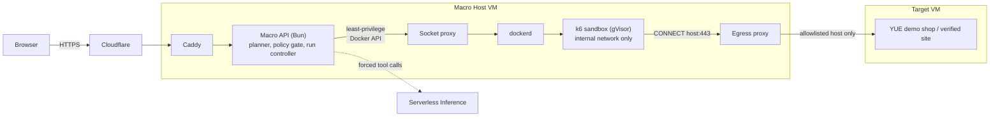
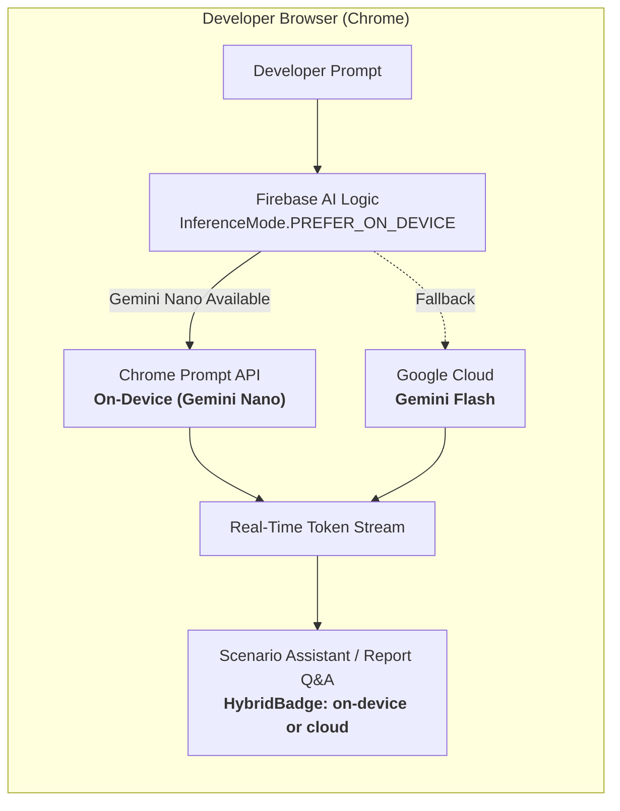

# Macro

**Know your breaking point before your users do.**

Describe the traffic you expect in plain words ("a new banner drops tonight, 500 players open the store, 10% order"). An AI agent drafts a staged load test, fixed code checks it, you approve it, and k6 runs it inside a sandbox that can reach only the demo shop or your verified site. You get a capacity report: safe capacity, breaking point, and the first route that slowed down.

- Website: **https://macro.my.id** · App: **https://macro.my.id/app/** (signed-out demo protected by Cloudflare Turnstile; sign in for private own-site testing)

**The model proposes, code decides.** The AI drafts the plan, advises whether to continue after each stage, and explains the result. The target, limits, k6 script, sandbox settings, stop rules, and every number in the report come from fixed, deterministic code.

## Architecture



A run, step by step:

1. **Plan.** The Planner turns your description into a staged plan. For the demo shop, it targets the allowlisted store catalog; for verified own-site origins, it plans journeys across routes discovered directly from the site. Your text is passed to the model as untrusted data.
2. **Gate.** A deterministic policy gate checks the plan: exact target match, known routes only, 1 to 6 stages, at most 500 VUs per stage, at most 600 s in total. A rejected plan has no approve button.
3. **Approve.** The approved plan is stored under its SHA-256 hash. The run executes exactly that text, and re-checks the hash and the gate before starting.
4. **Run.** Each stage renders k6 from a fixed template and runs it in a fresh sandbox. Your text never reaches the script.
5. **Supervise.** After each stage the Supervisor answers `continue` or `stop`. A failing stage stops the run whatever the model says.
6. **Report.** All numbers come from k6's measurements. The AI explanation sits in its own section, and any number in it that doesn't match a measured value causes the text to be withheld.

## Containment & Security

| Rule | How Macro enforces it |
| --- | --- |
| **Process isolation** | k6 runs under gVisor (`runsc`) as a non-root user, with a read-only root filesystem, all capabilities dropped and `no-new-privileges`. The sandbox gets no Docker socket. |
| **Network isolation** | The sandbox sits on a per-run Docker network with no route out. Its only exit is an egress proxy that allows HTTPS `CONNECT` to the exact allowlisted host on port 443. The proxy refuses IP literals, private, link-local and metadata addresses (`169.254.169.254`), and the Macro VM itself. |
| **Docker socket proxy** | `macro-api` holds no Docker socket. It talks to Docker through a socket proxy ([`deploy/macro/docker-compose.yml`](deploy/macro/docker-compose.yml)) that forwards only the container/network/image-inspect endpoints Macro uses, and answers 403 for everything else: exec, build, image pull, volumes, secrets, swarm. |
| **Secret hygiene** | The sandbox environment holds only the proxy address. API keys live in the `macro-api` container only. |
| **Resource limits** | 1 GiB memory with no swap, 1 CPU, 256 processes. A sandbox that runs past the stage time plus 30 s is killed. |
| **Lifecycle cleanup** | Every sandbox is force-removed after it exits, and "Sandbox removed" is logged only after Docker confirms it is gone. When a run ends, its network and proxy are removed too. Leftovers are swept at startup. |
| **Deterministic guards** | The policy gate, the script template, plan-hash approval, stop-on-failure and the number check on AI text are all plain code with property tests. |

Main code: [`src/sandbox/runner.ts`](src/sandbox/runner.ts), [`proxy/ip.ts`](proxy/ip.ts), [`src/plan/policy.ts`](src/plan/policy.ts), [`src/k6/script.ts`](src/k6/script.ts), [`src/report/number-guard.ts`](src/report/number-guard.ts).

Only the `socket-proxy` container mounts the Docker socket, and it forwards a fixed allowlist of Docker API endpoints to `macro-api` over the Compose network. No request can choose an image, mount, network or command — those all come from code constants, and the API cannot reach the endpoints that would let it do otherwise. The real-container test suite (`bun run test:vm`) runs the whole sandbox loop through this proxy, so a missing endpoint fails CI before a deploy does.

## Client-Side Hybrid AI (Firebase AI Logic)

Macro incorporates client-side **Hybrid Inference** via the official **Firebase AI Logic SDK** (`firebase/ai`), providing private, zero-quota AI assistance that prefers on-device execution (Chrome Gemini Nano via the Prompt API) and automatically falls back to cloud Gemini when on-device models are unsupported.



### Hybrid AI Capabilities

| Capability | What It Does | Why On-Device Matters |
| --- | --- | --- |
| **Scenario Assistant** | Refines plain-English traffic descriptions (injecting realistic ramp-ups, peak spikes, and catalog mixes) before plan generation. | **Zero server quota & instant latency:** Developers iterate freely on traffic drafts right on their machine without consuming server planning limits or sending unapproved drafts over the wire. |
| **Report Q&A** | Answers conversational questions about completed runs grounded strictly in measured metrics (`p95` latencies, breaking points, route errors), with client-side Number Guard checks. | **Strict grounding & privacy:** Uses the structured `CapacityReport` numbers directly in the browser to explain results without hallucinations. |
| **Origin Transparency** | Pre-flight availability badge (`On-Device Model: Gemini Nano`, `Gemini Nano downloading`, `On-Device Only: Unavailable`, `Cloud Model: <model>`) and **Stop** stream control. | Users can see where their prompt will run before clicking and cancel streams mid-flight. |
| **Remote Config Tuning** | Manages `hybrid_ai_enabled`, `hybrid_inference_mode`, `hybrid_cloud_model`, `scenario_assistant_instruction`, and `report_qa_system_instruction` via `firebase/remote-config` ([`remoteconfig.template.json`](remoteconfig.template.json)), with built-in safe defaults. | Swap cloud fallback models, switch inference modes, tune prompts, or trip an emergency kill switch without redeploying—while staying offline-safe. |
| **App Check Hardening** | Protects cloud inference fallbacks with `ReCaptchaEnterpriseProvider` and limited-use App Check tokens. | Defends the project backend from unauthorized abuse. |

### Running Gemini Nano Locally in Chrome

To run client-side inference on-device using Chrome's built-in Gemini Nano:

1. Ensure Chrome (v128+) on-device AI flags are enabled:
   - `chrome://flags/#prompt-api-for-gemini-nano` → **Enabled**
   - `chrome://flags/#optimization-guide-on-device-model` → **Enabled BypassPrefRequirement**
2. In `chrome://components`, verify the **Optimization Guide On Device Model** component is downloaded and up to date.
3. In Macro's **Test Studio**, open **Scenario Assistant** or **Report Q&A**: prompts execute directly on-device with real-time streaming, marked with the **`On-device · Gemini Nano`** badge.

## Quickstart & Demo Walkthrough

### 1. Try a Load Test

1. Open https://macro.my.id/app/. Pick an example scenario such as **Campaign spike**, or write your own, then submit.
2. Review the draft plan (stages, journey, stop thresholds) and click **Approve & Run**.
3. Watch the stages run live. A typical 4-stage run (25, 50, 100, 200 VUs) takes about 4.5 minutes.
4. Read the report: safe capacity, breaking point, first degraded route, p95 and error-rate charts, per-route tables, per-second stage latency charts, and the AI explanation.
5. **Re-run** the same plan to compare multiple runs side by side.

Example result from the live deployment: safe capacity was 100 VUs; at 200 VUs, `store_home` was the first route to slow down, at p95 1,611 ms (limit 1,500 ms).

### 2. Verify Containment (Probe)

1. Open https://macro.my.id/app/, complete the Turnstile check, and click **Run containment probe**.
2. A fixed k6 script ([`src/k6/probe.js`](src/k6/probe.js)) tests five security boundaries from inside an active sandbox:
   - HTTPS request to `example.com` (non-allowlisted target)
   - HTTP request to the cloud metadata address `169.254.169.254`
   - Direct request to the internal Macro API
   - Environment variable scan for `KEY`, `SECRET`, or `TOKEN`
   - Memory allocation exceeding 1 GiB
3. Expected result: all five actions are **contained**. The execution timeline displays three blocked egress attempts, memory cap enforcement, and immediate sandbox teardown.

The hero preview (**Drafted plan checked by policy gate**) on the landing page also demonstrates how the deterministic gate checks and rejects invalid plans (**Campaign spike**, **Unverified host**, **Over 500 VUs**) before execution.

## Infrastructure & Cloud Services

| Layer / Service | Role in Macro |
| --- | --- |
| **API & Sandbox Host** | Runs the Macro API and web UI (Bun), Caddy, Docker socket proxy, egress proxy, and gVisor sandboxes (1 vCPU / 2 GB compute). |
| **Demo Target** | Isolated environment hosting the demo copy of the YUE web shop (web, API, Postgres, Redis) at `yue.macro.my.id`. |
| **Serverless Inference** | Powers server-side agents: Planner, Supervisor, and Report Writer. Each call forces a single deterministic tool (`propose_plan`, `decide_next_stage`, `write_report`). Every call displays model, latency, and token usage in the UI. |
| **Edge & Ingress Firewall** | Cloudflare proxy and edge firewall; inbound ports 80/443 accept only verified Cloudflare IP ranges to block direct origin bypass and spoofed IP headers ([`deploy/macro/vultr-firewall.sh`](deploy/macro/vultr-firewall.sh)). |

## Setup & Deployment

### Host VM Setup (Ubuntu 24.04)

```bash
git clone https://github.com/mbayue/macro.git /opt/macro && cd /opt/macro
sudo bash deploy/macro/install-gvisor.sh          # registers runsc with Docker
cp .env.example .env && chmod 600 .env            # fill in the secrets
# put the Cloudflare Origin CA cert and key in /etc/macro/tls/origin.pem and origin.key
deploy/macro/vultr-firewall.sh --dry-run          # optional; configure cloud firewall rules
docker compose -f deploy/macro/docker-compose.yml up -d --build
curl https://macro.my.id/healthz                  # {"ok":true}
```

Main configuration settings (full list in [`.env.example`](.env.example) and [`src/config.ts`](src/config.ts)):

| Setting | Notes |
| --- | --- |
| `INFERENCE_API_KEY` | Required, secret. Server-side LLM inference API key (aliases: `VULTR_INFERENCE_API_KEY`, `AI_API_KEY`). Compatible with any OpenAI-compatible endpoint. |
| `INFERENCE_BASE_URL` | Required. Base HTTP(S) URL for the OpenAI-compatible inference endpoint (alias: `VULTR_INFERENCE_BASE_URL`). |
| `INFERENCE_MODEL`, `INFERENCE_FALLBACK_MODEL` | Required. Primary model name and fallback model name (aliases: `VULTR_INFERENCE_MODEL`, `VULTR_INFERENCE_FALLBACK_MODEL`). |
| `FIREBASE_API_KEY`, `FIREBASE_APP_ID`, `FIREBASE_PROJECT_ID` | Required. Powers client-side Hybrid AI via `firebase/ai` (`PREFER_ON_DEVICE`) with on-device Gemini Nano and cloud fallback (plus optional `FIREBASE_AUTH_DOMAIN`, `FIREBASE_MEASUREMENT_ID`, `FIREBASE_APPCHECK_SITE_KEY`). |
| `TURNSTILE_SECRET_KEY`, `TURNSTILE_SITE_KEY` | Required. Cloudflare Turnstile keys (test keys work locally). |
| `TARGET_ORIGINS` | The allowed origins: web origin followed by API origin. |
| `SANDBOX_RUNTIME` | `runsc` (default) or `runc` to opt out of gVisor. |
| `K6_IMAGE` | Pinned by `@sha256:` digest. |
| `TIGERDATA_URL` | Optional, secret. `postgres://` connection string for external telemetry mirroring (SQLite remains the primary source of truth). |
| Auth block (optional) | `SESSION_SECRET`, `PUBLIC_BASE_URL`, `RESEND_API_KEY`, `RESEND_FROM`. Omit to run in signed-out demo mode; set all to enable user accounts and magic-link sign-in. |
| GitHub OAuth (optional) | `GITHUB_CLIENT_ID`, `GITHUB_CLIENT_SECRET`, `GITHUB_REDIRECT_URI` (requires auth block). Enables **Continue with GitHub**. |
| Google OAuth (optional) | `GOOGLE_CLIENT_ID`, `GOOGLE_CLIENT_SECRET`, `GOOGLE_REDIRECT_URI` (requires auth block). Enables **Continue with Google**. |

If any sandbox prerequisite is missing (Docker, gVisor, or proxy image), the API starts but safely refuses runs, reporting the issue via `GET /api/config`.

### Accounts and Own-Site Testing

Authentication is optional. Without the auth environment variables, Macro runs in self-contained demo mode targeting allowlisted demo hosts.

When auth is configured:

1. Open `/app/#/sign-in` (GitHub OAuth or Resend magic link). GitHub must provide a verified email. Once signed in, account management is available at `/app/#/account` (including complete account deletion via `DELETE /api/me`).
2. On **New test**, choose **Demo shop** (public, works signed out) or **My site** (requires sign-in and a verified origin).
3. Verify one HTTPS host via a DNS TXT record at `_macro-verify.<host>` or a file at `/.well-known/macro-site-verification` containing the verification token. Once verified, Macro automatically discovers client routes from the site's document and scripts to constrain journey planning.
4. Own-site runs are private to the account; demo runs stay public and can be claimed onto the account from browser recent-runs after sign-in.

### Demo Target VM

YUE is an independent demo store. [`deploy/yue-demo/`](deploy/yue-demo/) contains its deployment configuration:

- Rate-limit allowlist patch for the Macro generator VM's IP, applied only to throwaway checkouts.
- Environment template with fresh local credentials.
- Compose override and Caddyfile.
- Seed catalog data, test order cleanup scripts, and health checks.

### Local Development

```bash
bun install
bun test             # run unit and property tests, no Docker needed
bun run check        # typecheck with tsc --noEmit
bun run build:web    # build /app/ and prerender landing site at /, /privacy, /terms
bun run dev          # run API; serves web/dist on http://localhost:3000
bun run dev:landing  # optional: Vite dev server for landing site with hot reload (port 5173)
bun run test:vm      # real-Docker containment tests; requires Docker
```

The landing site and planner app are React + Vite in `web/landing/`. Landing pages are prerendered at build time and hydrated in the browser; `/app/` is client-rendered. Both enforce strict CSP (no inline scripts or style attributes).

### Local Development on Windows

Bun cannot open Docker Desktop's named pipe using Unix socket semantics. Set `DOCKER_HOST` to the named pipe using the `pipe://` scheme:

```bash
set DOCKER_HOST=pipe://\\.\pipe\docker_engine
bun run dev
```

With this configured, runs execute locally using `runc` (relative `DATA_DIR` paths resolve to absolute paths at startup).

### Waitlist Administration

`POST /api/waitlist` records verified email sign-ups with rate limiting. On the host VM:

```bash
docker exec macro-api bun src/admin/waitlist.ts list              # CSV export: email, signed up, invited, joined
docker exec macro-api bun src/admin/waitlist.ts invite <email>    # send individual invite (--force re-sends)
docker exec macro-api bun src/admin/waitlist.ts invite --all      # send invites to all pending addresses
docker exec macro-api bun src/admin/waitlist.ts remove <email>    # handle user deletion request
```

Invites are delivered via Resend. The first sign-in from an invited address automatically timestamps activation.

## Limits

- **Targets are strictly gated.** Signed-out users may only target the demo allowlist. Authenticated users may target one verified HTTPS origin (DNS TXT or `/.well-known/`).
- **Load generator capacity.** One generator in Singapore with 1 CPU per sandbox. At high VU counts, generator resources can saturate.
- **"First degraded route" is an observation, not a root cause.**
- **Quotas:** One active run at a time, rolling planning and start rate-limits, daily start caps, and a 15-minute maximum per run (usage exposed via `GET /api/quota` and displayed on **New test**).
- **Not built:** Distributed load generation across multiple cloud regions, multi-tenant team accounts, and own-site containment probes.

## Testing

`bun test` runs the unit and property suite ([fast-check](https://fast-check.dev)). Tests cover the plan parser, policy gate against an independent reference model, script generation, proxy decisions, sandbox lifecycle with mock Docker, metrics and verdicts, agent fallbacks, number verification, run comparison, account auth, origin verification (DNS TXT, well-known, Domain Connect), route discovery, drafts, run privacy, quota enforcement, account deletion, and security headers.

`bun run test:vm` runs the real-container suite (`test/vm/`) against a real Docker daemon: verifying k6 stage execution, egress proxy filtering, OOM enforcement on memory limits, timeout termination, startup sweep of orphaned resources, and end-to-end containment probes. The suite is opt-in (`MACRO_VM_TEST=1`) and verifies real runtime behavior safely. GitHub Actions runs both suites on push ([.github/workflows/ci.yml](.github/workflows/ci.yml)).

## License

MIT. Built with Bun, k6, gVisor, Caddy, zod, fast-check, Cloudflare Turnstile, and Firebase AI Logic.
