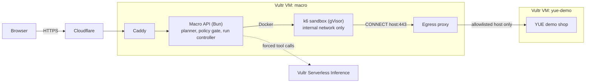

# Macro

**Know your breaking point before your users do.**

Describe the traffic you expect in plain words ("a new banner drops tonight, 500 players open the store, 10% order"). An AI agent drafts a staged load test, fixed code checks it, you approve it, and k6 runs it inside a sandbox that can reach only the demo shop. You get a capacity report: safe capacity, breaking point, and the first route that slowed down.

- Website: **https://macro.my.id** · live demo app: **https://macro.my.id/app/** (no sign-in, protected by Cloudflare Turnstile)
- Built for lablab.ai **Vultr: Agent Rush**, Challenge 1 "Blast Radius Zero"

**The model proposes, code decides.** The AI drafts the plan, advises whether to continue after each stage, and explains the result. The target, limits, k6 script, sandbox settings, stop rules and every number in the report come from fixed code.

## How Macro uses Vultr

| Vultr product | Used for |
| --- | --- |
| **Cloud Compute** `macro` (Singapore, 1 vCPU / 2 GB) | Macro API and web UI (Bun), Caddy, the egress proxy, and one gVisor sandbox per load-test stage. |
| **Cloud Compute** `yue-demo` (Singapore, 1 vCPU / 2 GB) | The only allowed target: a demo copy of the YUE web shop (web, API, Postgres, Redis) at `yue.macro.my.id`. |
| **Serverless Inference** | All three agents: Planner, Supervisor and Report Writer. Each call forces a single tool (`propose_plan`, `decide_next_stage`, `write_report`). Model `minimax-m3.1-flash`, with one fallback attempt on `mimo-v2.6-flash`. Every call is shown in the UI with model, latency and tokens. |
| **Firewall** | Inbound 80/443 on `macro` accepts only Cloudflare IP ranges, so the origin can't be reached directly and the client IP header can't be spoofed. Script: [`deploy/macro/vultr-firewall.sh`](deploy/macro/vultr-firewall.sh). |

## Architecture



A run, step by step:

1. **Plan.** The Planner turns your description into a staged plan. Your text is passed to the model as untrusted data.
2. **Gate.** A deterministic policy gate checks the plan: exact target match, known routes only, 1 to 6 stages, at most 500 VUs per stage, at most 600 s in total. A rejected plan has no approve button.
3. **Approve.** The approved plan is stored under its SHA-256 hash. The run executes exactly that text, and re-checks the hash and the gate before starting.
4. **Run.** Each stage renders k6 from a fixed template and runs it in a fresh sandbox. Your text never reaches the script.
5. **Supervise.** After each stage the Supervisor answers `continue` or `stop`. A failing stage stops the run whatever the model says.
6. **Report.** All numbers come from k6's measurements. The AI explanation sits in its own section, and any number in it that doesn't match a measured value causes the text to be withheld.

## Containment

| Rule | How Macro enforces it |
| --- | --- |
| Process isolation | k6 runs under gVisor (`runsc`) as a non-root user, with a read-only root filesystem, all capabilities dropped and `no-new-privileges`. The sandbox gets no Docker socket. |
| Network | The sandbox sits on a per-run Docker network with no route out. Its only exit is an egress proxy that allows HTTPS `CONNECT` to the exact allowlisted host on port 443. The proxy refuses IP literals, private, link-local and metadata addresses (`169.254.169.254`), and the Macro VM itself. |
| Secret hygiene | The sandbox environment holds only the proxy address. API keys live in the `macro-api` container only. |
| Resource limits | 1 GiB memory with no swap, 1 CPU, 256 processes. A sandbox that runs past the stage time plus 30 s is killed. |
| Lifecycle | Every sandbox is force-removed after it exits, and "Sandbox removed" is logged only after Docker confirms it is gone. When a run ends, its network and proxy are removed too. Leftovers are swept at startup. |
| Fixed rules | The policy gate, the script template, plan-hash approval, stop-on-failure and the number check on AI text are all plain code with property tests. |

Main code: [`src/sandbox/runner.ts`](src/sandbox/runner.ts), [`proxy/ip.ts`](proxy/ip.ts), [`src/plan/policy.ts`](src/plan/policy.ts), [`src/k6/script.ts`](src/k6/script.ts), [`src/report/number-guard.ts`](src/report/number-guard.ts).

One trust boundary to know about: `macro-api` mounts the Docker socket, so it is root-equivalent on the VM. That is why no request can choose an image, mount, network or command. Those all come from constants.

## See it contained

1. Open https://macro.my.id/app/, complete the Turnstile check and click **Run containment probe**.
2. A fixed k6 script ([`src/k6/probe.js`](src/k6/probe.js)) tries five things from inside a sandbox:
   - HTTPS to `example.com`, which is not allowlisted
   - HTTP to the cloud metadata address `169.254.169.254`
   - a request to the Macro API
   - a scan of environment variable names for `KEY`, `SECRET` or `TOKEN`
   - an allocation of more than 1 GiB of memory
3. Expected result: all five **contained**. The timeline shows Egress blocked three times, Memory cap hit, then Sandbox removed.

The panel **See the policy gate block a hostile plan** sends three hostile plans (another website, far too much load, an unknown route) through the same gate the approval uses. Each one is rejected with its rule violations, and 0 requests are sent. No model is involved.

## Try a load test

1. Pick an example such as **Gacha banner launch**, or write your own, then submit.
2. Review the draft plan (stages, journey, stop thresholds) and press **Approve and run**.
3. Watch the stages run live. A typical 4-stage run (25, 50, 100, 200 VUs) takes about 4.5 minutes.
4. Read the report: safe capacity, breaking point, first degraded route, a p95 and error-rate chart, per-route tables and the AI explanation.
5. **Re-run** the same plan and compare two runs side by side.

Example result from the live deployment: all four stages passed and safe capacity was 200 VUs. `store_home` was the first route to slow down, at p95 1,611 ms at 200 VUs (limit 1,500 ms).

## Setup

### Macro VM (Ubuntu 24.04)

```bash
git clone https://github.com/mbayue/macro.git /opt/macro && cd /opt/macro
sudo bash deploy/macro/install-gvisor.sh          # registers runsc with Docker
cp .env.example .env && chmod 600 .env            # fill in the secrets
# put the Cloudflare Origin CA cert and key in /etc/macro/tls/origin.pem and origin.key
deploy/macro/vultr-firewall.sh --dry-run          # optional; needs VULTR_API_KEY in the shell
docker compose -f deploy/macro/docker-compose.yml up -d --build
curl https://macro.my.id/healthz                  # {"ok":true}
```

Main settings (full list in [`.env.example`](.env.example) and [`src/config.ts`](src/config.ts)):

| Setting | Notes |
| --- | --- |
| `VULTR_INFERENCE_API_KEY` | Required, secret. |
| `TURNSTILE_SECRET_KEY`, `TURNSTILE_SITE_KEY` | Required. Cloudflare's test keys work locally. |
| `TARGET_ORIGINS` | The whole allowlist: the web origin, then the API origin. |
| `SANDBOX_RUNTIME` | `runsc` (default) or `runc` to opt out of gVisor. |
| `K6_IMAGE` | Must be pinned by `@sha256:` digest. |

If a sandbox prerequisite is missing (Docker, gVisor, the proxy image), the API still starts but refuses every run, and `GET /api/config` names the problem.

### Demo target VM

YUE is a separate, pre-existing project and isn't in this repo. [`deploy/yue-demo/`](deploy/yue-demo/) holds what the demo copy needs:

- a rate-limit allowlist patch for the Macro VM's IP, applied only to the throwaway checkout
- an env template with fresh local secrets
- a Compose override and a Caddyfile
- seed data, a cleanup script for test orders, and smoke checks

### Local development

```bash
bun install
bun test             # 431 tests, no Docker needed
bun run check        # tsc --noEmit
bun run build:web    # the app at /app/ and the prerendered landing site at /, /privacy, /terms
bun run dev          # the API; serves web/dist
bun run dev:landing  # optional: Vite dev server for the landing site with hot reload (port 5173)
```

The landing site is React + Vite in `web/landing/`. Pages are prerendered at build time and hydrated in the browser, so they work under the strict CSP (no inline scripts or style attributes).

### Waitlist

`POST /api/waitlist` stores an email (normalised, once) after a Turnstile check, with at most 5 sign-ups per IP per hour. Only the email and the sign-up time are stored. On the VM:

```bash
docker exec macro-api bun src/admin/waitlist.ts list            # CSV
docker exec macro-api bun src/admin/waitlist.ts remove <email>  # deletion request
```

## Limits

- **Only the demo target can be tested.** Arbitrary targets would make Macro a DDoS tool. Domain verification with a DNS TXT record is future work.
- **One load generator** in Singapore with 1 CPU per sandbox. At high VU counts, the generator itself can become the limit.
- **"First degraded route" is an observation, not a root cause.**
- **Demo quotas:** one active run at a time, 6 starts per client per hour, 50 per day, and a 15-minute cap per run.
- **Not built:** regional runs from other Vultr regions, and report export.

## Testing

`bun test` runs 431 unit and property tests ([fast-check](https://fast-check.dev)). They cover the plan parser, the policy gate against an independent reference model, script generation, the proxy decision, sandbox lifecycle with a fake Docker, metrics and verdicts, agent fallbacks, the number check and run comparison. Sandbox behaviour on a real VM is checked by the live probe.

## License

MIT. Built with Bun, k6, gVisor, Caddy, zod, fast-check, Cloudflare Turnstile and Vultr Serverless Inference.
