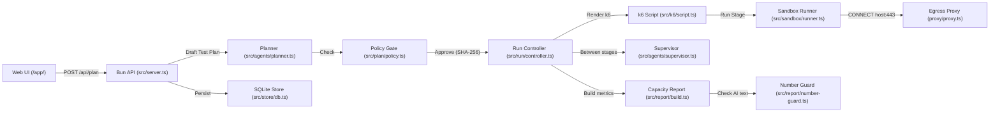

# Macro Architecture

Macro is a Bun + TypeScript backend (`src/`) paired with a React 19 + Vite frontend (`web/landing/`). For domain terminology, see [GLOSSARY.md](../GLOSSARY.md).

## End-to-End Flow



## Module Map

| Area | Path | Responsibility |
| --- | --- | --- |
| Entrypoint & Config | `src/main.ts`, `src/config.ts`, `src/server.ts` | Env parsing (`parseConfig`), HTTP/SSE routing, CSP & security headers, static serving |
| Shared Contracts | `src/types.ts`, `src/api-types.ts` | Core domain types and API request/response shapes |
| Server Agents | `src/agents/` | OpenAI-compatible Serverless Inference client (`inference.ts`), `planner.ts`, `supervisor.ts`, `reporter.ts` |
| Planning & Gate | `src/plan/` | Route catalog (`catalog.ts`), own-site discovery (`discover.ts`), schema/parser/printer, deterministic `policy.ts` |
| k6 & Sandbox | `src/k6/`, `src/sandbox/`, `proxy/` | Fixed k6 script rendering (`script.ts`), `probe.js`, Docker/gVisor `runner.ts`, egress allowlist proxy (`proxy/ip.ts`, `proxy/proxy.ts`) |
| Run Execution | `src/run/` | Concurrency admission, stage controller, stop/verdict rules (`decide.ts`, `verdict.ts`), quotas/limits, containment probes |
| Capacity Report | `src/report/` | Deterministic report builder (`build.ts`), run comparison (`compare.ts`), CSV/JSON export (`export.ts`), `number-guard.ts` |
| Auth & Own-Site | `src/auth/`, `src/security/` | Optional GitHub & Google OAuth, magic-link email, signed sessions, origin verification (`verify-origin.ts`, `domain-connect.ts`), Turnstile & client IP checks |
| Persistence | `src/store/db.ts`, `src/metrics/tiger.ts` | SQLite source of truth (`DATA_DIR`), optional best-effort Tiger Cloud per-second sample mirror |
| Web Frontend | `web/landing/` | Prerendered landing/legal pages (`src/`) + client-rendered React 19 `/app/` workspace (`src/app/` with TanStack Router hash URLs, Tailwind CSS v4 tokens, shadcn/ui on Base UI, self-hosted Geist Mono) |
| Hybrid AI & Firebase (Client) | `web/landing/src/app/lib/hybrid-ai.ts`, `scenario-templates.ts`, `HybridBadge.tsx`, `ScenarioAssistant.tsx`, `ReportQa.tsx`, `remoteconfig.template.json`, `firestore.rules` | Client-side Firebase AI Logic (`PREFER_ON_DEVICE`: Gemini Nano with Gemini 3.8 Flash cloud fallback), App Check limited-use tokens, Firebase Remote Config tuning, and offline-cached Cloud Firestore catalog (`scenario_templates`, `qa_prompts`, `featured_runs`) plus real-time `announcements` (`onSnapshot`) |
| Build & Scripts | `scripts/` | Web build (`build-web.ts`), CSP/React 19/layout checks (`build-web-check.ts`), E2E & local stage/probe helpers |

## Development Commands

```bash
bun run check        # TypeScript typecheck (tsc --noEmit)
bun run test:web     # Fast frontend router, view, component, and CSP check tests
bun test             # Full unit & integration test suite (no Docker required)
bun run build:web    # Build landing + /app/ into web/dist + validate source & dist checks
bun run dev          # Start Bun API server with watch mode
bun run dev:landing  # Start Vite dev server (proxies /api to localhost:3000)
bun run test:vm      # Real-container sandbox tests (requires MACRO_VM_TEST=1 & Docker)
```
